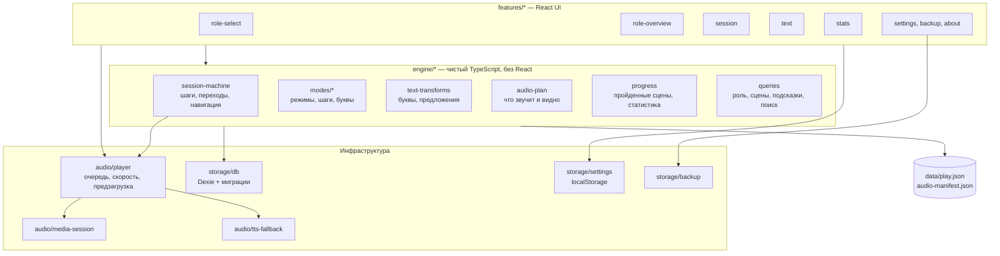
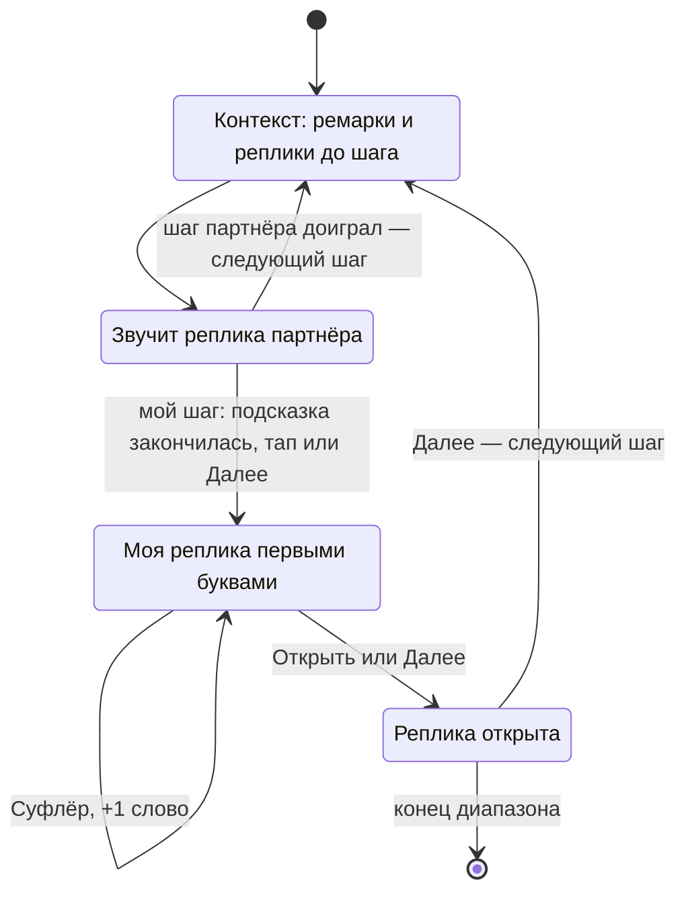
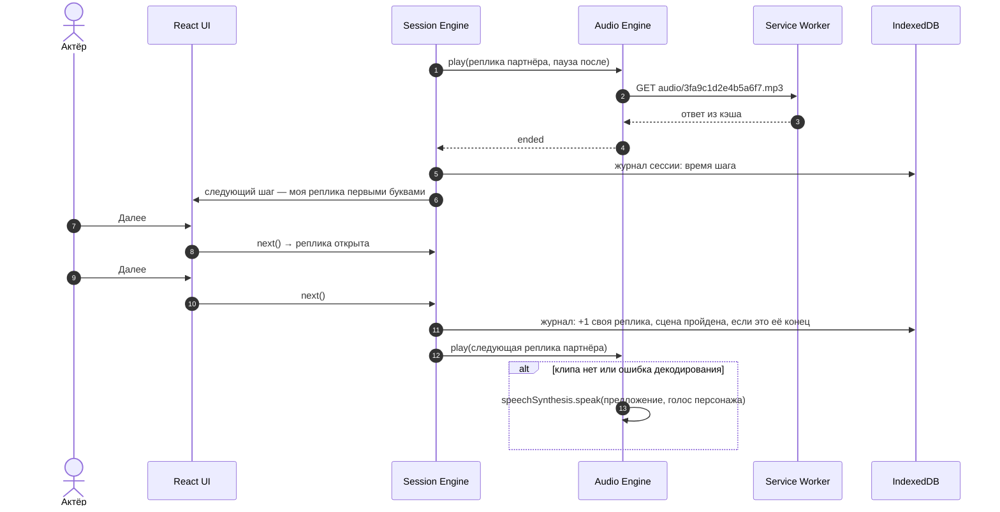
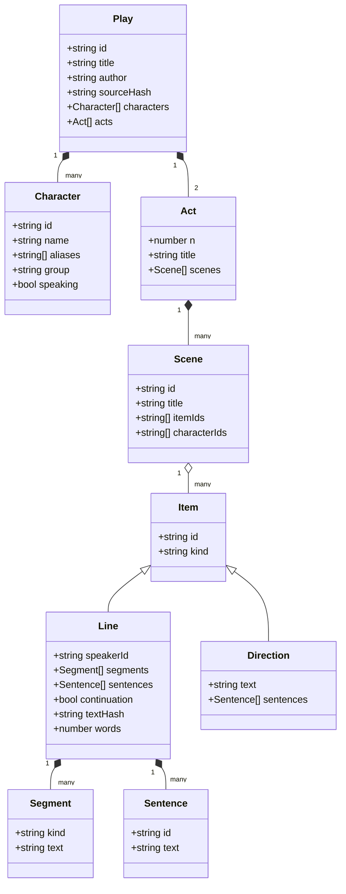
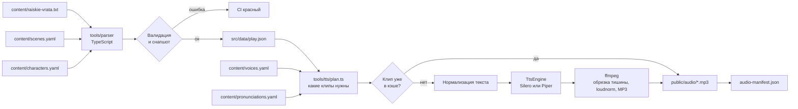
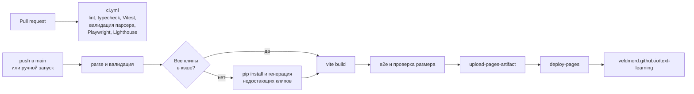
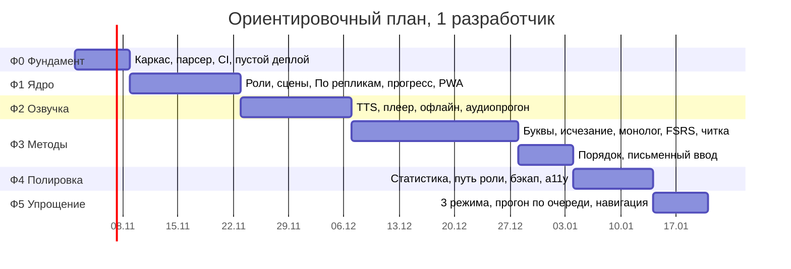

# «Учить текст»: архитектура сервиса

> **Статус:** реализовано в коде (фазы Ф0–Ф5), осталась выверка озвучки на слух и ручная матрица устройств · **Дата:** 24.10.2026 · **Пьеса:** В. Красногоров, «Райские врата» · **Репозиторий:** [Veldmord/text-learning](https://github.com/Veldmord/text-learning)

Сервис помогает актёрам труппы выучить свою роль дословно и вовремя вступать по реплике партнёра. Это статическое PWA на GitHub Pages: без бэкенда, текст пьесы зашит в сборку, реплики партнёров озвучивают заранее сгенерированные нейроголоса.

## Содержание

1. [Цели и не-цели](#1-цели-и-не-цели)
2. [Исходные данные: пьеса](#2-исходные-данные-пьеса)
3. [Как актёры учат текст: исследование и выводы](#3-как-актёры-учат-текст-исследование-и-выводы)
4. [Требования](#4-требования)
5. [Режимы тренировки](#5-режимы-тренировки)
6. [Озвучка, скорость и удобство](#6-озвучка-скорость-и-удобство)
7. [Архитектура](#7-архитектура)
8. [Модель данных](#8-модель-данных)
9. [Контент-пайплайн: текст и голоса](#9-контент-пайплайн-текст-и-голоса)
10. [Аудиодвижок](#10-аудиодвижок)
11. [Офлайн, хранилище, обновления](#11-офлайн-хранилище-обновления)
12. [Сборка и деплой](#12-сборка-и-деплой)
13. [Безопасность, приватность, доступность, диагностика](#13-безопасность-приватность-доступность-диагностика)
14. [Структура репозитория и стек](#14-структура-репозитория-и-стек)
15. [Тестирование](#15-тестирование)
16. [Риски](#16-риски)
17. [План поставки](#17-план-поставки)
18. [Открытые вопросы и допущения](#18-открытые-вопросы-и-допущения)
19. [Источники](#19-источники)

---

## 1. Цели и не-цели

**Цели**

- Актёр выбирает свою роль (или несколько) и учит её до дословного воспроизведения.
- Актёр знает, **когда** вступать: тренируется не на голом тексте, а на реплике-подсказке партнёра.
- Актёр может выбрать метод под этап работы: текст с подсвеченной ролью, первые буквы, прогон сцены с буквами (все реплики по очереди или сразу к своим), аудиопрогон.
- Тренировка занимает минимум времени: партнёры звучат сразу, скорость регулируется, озвучивать можно только хвост реплики-подсказки.
- Всё работает на телефоне, включая режим без сети (метро, закулисье).

**Не-цели**

- Бэкенд, аккаунты, синхронизация прогресса между устройствами (есть ручной экспорт/импорт файла).
- Распознавание речи: проверку делает сам актёр (первые буквы → «Открыть» → сверить).
- Оценки и интервальное повторение: в версии Ф5 их убрали, прогресс считается по пройденным сценам и времени (раздел 5.3).
- Загрузка и редактирование других пьес из интерфейса. Архитектура пайплайна позволяет добавить пьесу через репозиторий, но это не продуктовая функция.
- Совместные репетиции в реальном времени между устройствами.

**Критерии успеха** (метрики считаются локально на устройстве, в экране статистики)

- Актёр с первого запуска начинает тренировку своей роли меньше чем за минуту.
- К прогону все сцены роли пройдены целиком хотя бы раз, и есть серия дней тренировок.
- Прогон сцены идёт без лишних касаний: партнёры звучат сами, актёр трогает экран только на своей реплике.

---

## 2. Исходные данные: пьеса

Источник: `райские врата.txt` (UTF-8, 1054 строки, ~138 КБ). Пьеса в двух действиях, деления на сцены в тексте нет.

| Персонаж | Реплик | Слов | Доля реплик |
|---|---:|---:|---:|
| Девушка | 206 | 1 976 | 24,8 % |
| Молодой человек | 123 | 894 | 14,8 % |
| Дама | 117 | 1 045 | 14,1 % |
| Мужчина | 114 | 1 143 | 13,7 % |
| Старик | 107 | 1 342 | 12,9 % |
| Женщина | 101 | 1 085 | 12,2 % |
| Администратор | 52 | 268 | 6,3 % |
| Секретарша | 5 | 25 | 0,6 % |
| Первый санитар | 4 | 14 | 0,5 % |
| Второй санитар | 1 | 7 | 0,1 % |
| Шофёр | 1 | 5 | 0,1 % |
| **Итого** | **831** | **~7 800** | |

Числа совпадают со снапшотом парсера `tools/parser/__snapshots__/counts.json`: «реплик» — без 34 продолжений после ремарок, «слов» — с продолжениями. Слово — последовательность букв и цифр, дефисные слова («по-своему») считаются одним словом.

Без реплик: Сопровождающие, Некто.

**Особенности формата, которые учитывает парсер**

- Реплика: `ИМЯ. (ремарка.) текст (ремарка.) текст`. Имя набрано заглавными, inline-ремарки в скобках.
- Отдельный абзац без имени — ремарка («Пауза.», «Целуются.», описания действия). Всего 129 абзацев, ~14,3 тыс. символов.
- Строка с отступом в 4+ пробела продолжает реплику того же персонажа после ремарки. Таких строк 34. Пример — строки 57–58 файла: «Целуются.» → «Выключи своего Моцарта.» (Девушка).
- До строки «Действие первое» идут заголовок, предисловие автора и список действующих лиц, а в первой строке стоит служебное число «65747». Это метаданные, а не реплики.
- Маркеры: «Действие первое» (стр. 44), «Конец первого действия.» (стр. 594), «Действие второе» (стр. 601), «Конец» (стр. 1054).
- Объём речи ~45,4 тыс. символов, 1 611 предложений. 19 реплик длиннее 40 слов (21 вместе с продолжениями), самая длинная (Старик, стр. 480) — 222 слова.
- По входам и выходам персонажей в ремарках пьеса делится на 19 сцен: 9 в первом действии и 10 во втором (раздел 9.2).
- В тексте встречаются артефакты вёрстки («¬¬», мягкие переносы, неразрывные пробелы): парсер их удаляет.

---

## 3. Как актёры учат текст: исследование и выводы

### 3.1 Что известно

| Метод | Что показывают исследования и практика | Сила доказательств | Вывод для продукта |
|---|---|---|---|
| **Смысл прежде слов (active experiencing)** | Helga и Tony Noice изучали, как профессиональные актёры учат роли. Актёры не зубрят: они разбирают, *зачем* персонаж говорит реплику, и учат текст через намерение и действие. Испытуемые, которые представляли, что доносят смысл другому человеку, запоминали лучше, чем при механическом заучивании. Реплики, выученные в движении, вспоминались легче. При этом общая память у актёров не лучше: эффект даёт метод. | Серия экспериментов, обзор 2006 г. Экран **«Текст»**: вся пьеса с подсвеченной ролью, чтобы читать сцену целиком. **Аудиопрогон** в наушниках, чтобы учить на ходу. |
| **Активное вспоминание (retrieval practice, testing effect)** | Попытка вспомнить материал без подсказки укрепляет память сильнее, чем повторное чтение (Roediger & Karpicke, 2006). | Сильная, многократно воспроизведена | **«Прогон с буквами»** и **«Первые буквы»**: звучит партнёр, своя реплика показана первыми буквами, сначала вспоминаем, потом открываем. |
| **Интервальное повторение (spacing effect)** | Повторения, разнесённые во времени, дают лучшее долгосрочное удержание, чем массированные (метаанализ Cepeda et al., 2006). Современный алгоритм планирования — FSRS. | Сильная | Серия дней и время тренировок в статистике; трудные реплики актёр отмечает в **избранном** и начинает прогон с них. Планировщик (FSRS) убран в Ф5 вместе с оценками. |
| **Первые буквы слов** | Распространённый приём актёров (Роберт Дауни-младший и др.): записать только первые буквы слов с пунктуацией и восстанавливать текст по ним. | Практика актёров, научных данных мало | Режим **«Первые буквы»** — мостик от чтения к свободному вспоминанию. |
| **Исчезающие подсказки (vanishing cues)** | Подсказки постепенно убирают, пока человек не воспроизводит материал без них (Glisky, Schacter & Tulving, 1986). | Исследована в клинической нейропсихологии, принцип общий | В Ф5 режим убран: труппа учит по первым буквам и прогону. |
| **Разбиение на части и наращивание (chunking)** | Длинный фрагмент учат по смысловым кускам, каждый раз добавляя следующий: 1 → 1+2 → 1+2+3. | Классический приём, хорошо согласуется с рабочей памятью | В Ф5 режим убран; длинную реплику помогает пройти «Суфлёр» (+1 слово). |
| **Прогон с партнёром** | Приложения для актёров (CueUp, Cue-to-Cue, Line Please, ColdRead, LineLearner) сходятся на одном сценарии: партнёры озвучены, на своей реплике пауза, свою реплику можно приглушить или открыть. | Индустриальный консенсус | **Прогон с буквами** «все реплики по очереди», **аудиопрогон**, скорость по персонажу. |

### 3.2 Что берём из существующих приложений

| Функция | Где встречается | Берём? |
|---|---|---|
| Партнёры озвучены, на своей реплике пауза | CueUp, Cue-to-Cue, Line Please | Да, это основа |
| Скорость голоса по персонажу | CueUp | Да: общая скорость и множитель на персонажа |
| Прогрессивное скрытие (полный текст → первые буквы → скрыто) | CueUp | Да, отдельными режимами |
| Повтор пропущенной подсказки | Line Please | Да: кнопка 🔊 у реплики партнёра |
| Запись живых голосов труппы | Cue-to-Cue, LineLearner | Нет: без бэкенда записи некуда сохранить. Нейроголоса генерируются при сборке |
| Автоопределение конца своей реплики по голосу | ColdRead | Нет: распознавание речи вне рамок, проверку делает актёр |
| Импорт PDF/Word | LineLearner | Нет: пьеса одна и зашита в сборку |

### 3.3 Итог: порядок работы над ролью

```text
Текст → Первые буквы → Прогон с буквами → Аудиопрогон
                          ↑
            Избранное и навигация: вернуться к трудному месту
```

---

## 4. Требования

### 4.1 Функциональные

| ID | Требование |
|---|---|
| FR-01 | **Выбор роли.** Список персонажей с числом реплик и слов. Можно выбрать несколько ролей (совмещение, группа «Санитары»). Выбор запоминается. |
| FR-02 | **Обзор роли.** Главные кнопки «Открыть текст» и «Прогон с буквами», «Продолжить», «Первые буквы», «Аудиопрогон», избранное; карта сцен с числом своих реплик и пройденных прогонов; «Скачать роль для офлайна». |
| FR-03 | **Диапазон тренировки.** Вся роль / действие / одна или несколько сцен / от реплики до реплики. |
| FR-04 | **Режимы тренировки** из раздела 5. Режим переключается на лету без потери позиции. |
| FR-05 | **Своя реплика первыми буквами.** «Суфлёр» открывает следующее слово, «Открыть» — всю реплику. «Далее» сначала открывает реплику, потом ведёт дальше; «Назад» возвращает к предыдущему шагу. |
| FR-06 | **Озвучка партнёров** заранее сгенерированными нейроголосами, у каждого персонажа свой голос. Если клипа нет, говорит голос браузера (`speechSynthesis`). |
| FR-07 | **Настройки озвучки:** скорость, длина подсказки, ремарки, контекст «N реплик до моей», автопереход, паузы, озвучка своей реплики после «Открыть» («эхо»), ход прогона с буквами. |
| FR-08 | **Аудиопрогон в наушниках** с управлением с гарнитуры и экрана блокировки. |
| FR-09 | **Навигация по месту в диалоге:** лист «Навигация» в сессии (сцены и реплики, поиск по словам, избранное) и «Прогон отсюда» из текста. |
| FR-10 | **Прогресс и статистика:** пройденные сцены, прогоны по режимам, серия дней, время тренировок, сказанные свои реплики. |
| FR-11 | **Избранное:** любую реплику можно отметить в тексте, начать с неё прогон и найти её в листе навигации. |
| FR-12 | **Продолжение с места остановки** для каждой связки «роль + режим + диапазон». |
| FR-13 | **Офлайн:** установка PWA, загрузка аудио роли с индикатором прогресса. |
| FR-14 | **Экспорт и импорт прогресса** JSON-файлом (резервная копия, перенос на другое устройство). |
| FR-15 | **Отображение:** тема (светлая, тёмная, системная), размер шрифта, показ ремарок. |
| FR-16 | **Поиск по тексту** пьесы с переходом к реплике — на экране «Текст» и в листе навигации сессии. |
| FR-17 | **«О проекте»:** версия сборки, лицензии и атрибуция голосовых моделей, кнопка «Сообщить о проблеме». |

### 4.2 Нефункциональные

| ID | Требование | Цель | Как проверяем |
|---|---|---|---|
| NFR-01 | Скорость загрузки | LCP ≤ 2,0 с (мобильный профиль Lighthouse, 4G); начальный JS ≤ 200 КБ gzip; `play.json` ≤ 80 КБ gzip | Lighthouse CI с бюджетами в PR |
| NFR-02 | Отзывчивость | INP ≤ 200 мс; переход к следующей реплике ≤ 100 мс | Lighthouse, Playwright trace |
| NFR-03 | Задержка аудио | Старт клипа ≤ 150 мс после события, если клип в кэше; без щелчков между предложениями | Ручной QA, e2e с замером `playing` |
| NFR-04 | Офлайн | После «Скачать роль» без сети работают все функции для этой роли | Playwright `context.setOffline(true)` |
| NFR-05 | Сохранность данных | Прогресс переживает обновления приложения; схема мигрирует; есть бэкап | Юнит-тесты миграций, e2e обновления SW |
| NFR-06 | Совместимость | iOS Safari 16.4+, Android Chrome (2 последние версии), десктопные Chrome/Edge/Firefox/Safari (2 последние) | Playwright: chromium, webkit, firefox; ручная матрица устройств |
| NFR-07 | Доступность | WCAG 2.2 AA: контраст, зоны касания ≥ 44×44, фокус, озвучка скринридером | axe-core в Playwright, ручная проверка VoiceOver/TalkBack |
| NFR-08 | Безопасность | Нет сторонних скриптов и источников, CSP, зависимости без известных уязвимостей | CSP-тест, `npm audit`, Dependabot |
| NFR-09 | Приватность | Ни один байт пользовательских данных не покидает устройство; нет cookies и аналитики | Ревью кода, проверка сетевых запросов в e2e |
| NFR-10 | Размер сайта | ≤ 100 МБ (лимит Pages — 1 ГБ); аудио ≈ 25 МБ | Шаг CI проверяет размер `dist/` |
| NFR-11 | Время CI | Деплой ≤ 10 мин с тёплым кэшем TTS; холодная сборка ≤ 30 мин | Метрики Actions |
| NFR-12 | Поддерживаемость | TypeScript strict, ESLint; покрытие `engine/` ≥ 90 % строк; документ обновляется в том же PR, что меняет архитектуру | CI, ревью |

### 4.3 Ограничения платформы

- **GitHub Pages:** опубликованный сайт ≤ 1 ГБ; мягкий лимит трафика 100 ГБ/мес (при ~25 МБ аудио это ~4 000 полных загрузок роли в месяц — с большим запасом для труппы); деплой обрывается после 10 минут. Лимит 10 сборок в час на сборку через собственный workflow Actions не распространяется.
- **Нельзя задавать HTTP-заголовки.** CSP задаётся через `<meta>`. Cache-Control у Pages фиксирован (~10 мин), поэтому долгоживущий кэш обеспечивает Service Worker.
- **Нет серверной логики:** всё состояние живёт на устройстве. Сайт и текст публичны (решение владельца, см. риски).

---

## 5. Режимы тренировки

### 5.1 Обзор

В Ф5 труппа оставила три режима и экран текста. «Исчезающий текст», «Монолог по частям», «По репликам», «Слабые места», «Порядок» и «Письменный ввод» удалены вместе с оценками и FSRS: старые ссылки на них ведут в «Прогон с буквами» с тем же диапазоном.

| Режим | Механика | Когда применять |
|---|---|---|
| **Текст** *(экран, не режим)* | Вся пьеса, подсвечены только свои реплики. Переход к сцене, поиск по словам. Нажатие на реплику — «В избранное» и «Прогон отсюда». | Первая встреча со сценой, перечитать перед прогоном |
| **Прогон с буквами** *(главный)* | Сцена идёт лентой сверху вниз: реплики партнёров и ремарки видны и звучат, свои прошлые реплики открыты, текущая — первыми буквами. «Далее» на своей реплике открывает её, следующее «Далее» ведёт сцену дальше. Два хода (настройка «Ход прогона»): **«Все реплики по очереди»** — каждая реплика партнёра отдельный шаг, звучит и сама переходит к следующей, на своей реплике прогон останавливается; **«Сразу к моим репликам»** — шаги только свои, всё сказанное после своей прошлой реплики звучит подряд. | Связать реплики в сцену |
| **Первые буквы** | Звучит подсказка партнёра (длина и контекст — по настройкам озвучки), своя реплика показана первыми буквами: «Т н с в м и.». «Суфлёр» (+1 слово), «Открыть», «Далее». | Первые проходы по своим репликам |
| **Аудиопрогон** | Только звук. **«Подсказка → моя реплика»:** контекст и подсказка партнёра, на своей реплике тишина длиной ≈ своя реплика × k, дальше само. **«Вся пьеса»:** звучит всё, что сказано после своей предыдущей реплики, через границы сцен (не раньше начала диапазона, сцены без роли — по настройке); на своей реплике звук останавливается до «Продолжить» (кнопка, пробел или play на гарнитуре). В обоих вариантах — опциональное «эхо». | Метро, прогулка, перед репетицией |

Во всех режимах есть лист **«Навигация»**: сцены диапазона с репликами, поиск по ключевым словам и избранное. Выбор места до старта начинает сессию с него, во время сессии — переводит её туда. Если реплики нет среди шагов (например, реплика партнёра в «Первых буквах»), сессия встаёт на ближайший шаг после неё.

### 5.2 Общие правила

- **Первые буквы:** у каждого слова остаётся первая буква с исходным регистром. Пунктуация, тире и кавычки сохраняются. Дефисные слова сохраняют структуру: «по-своему» → «п-с». Числа не меняются. Inline-ремарки своей реплики показаны курсивом, если ремарки не «пропускать».
- **Прогон с буквами:** настройки «Контекст» и «Длина подсказки» не действуют — реплики партнёров звучат целиком; «только текст» выключает звук (в ходе «по очереди» прогон тогда сразу доходит до своей реплики, лента видна). Ремарки звучат голосом рассказчика по общей настройке — в начале шага следующей за ними реплики. Лента не выходит за границы сцены.
- **Все реплики по очереди:** шаги — все реплики диапазона по порядку текста, включая хвост сцены после последней своей реплики; сцены без своей роли пропускаются по настройке. После реплики партнёра выдерживается «Пауза между репликами». «Назад» со своей реплики снова играет реплику партнёра перед ней и возвращает к своей; «R» и кнопка 🔊 у подсказки делают то же.
- **Предложения:** граница — `.`, `!`, `?`, `…` перед пробелом и заглавной буквой, кавычкой или тире. Исключения: «т.д.», «т.п.», инициалы.

### 5.3 Прогресс без оценок

**Сцена пройдена**, когда в одной тренировке до очереди актёра дошли все его реплики этой сцены и он прошёл сцену до конца (шаг вперёд за её последнюю реплику диапазона). Прыжки по навигации не мешают: важно, что встретились все свои реплики. Каждая тренировка — запись журнала `sessions` (раздел 8.2): режим, активное время (на шаг засчитывается не больше 5 минут — дольше актёр отошёл от телефона), число своих реплик, дошедших до очереди, и пройденные сцены. Уход с экрана посреди шага тоже записывается.

На обзоре роли — «Пройдено сцен N из M» и время за 7 дней, в карте сцен — число прогонов и дата последнего, в статистике — прогоны по режимам, серия дней, время по дням.

---

## 6. Озвучка, скорость и удобство

### 6.1 Как сокращается время прослушивания

Оценка при темпе речи ~14 символов в секунду на скорости 1×:

| Роль | Вся пьеса | Все партнёры с первого выхода | Только реплика-подсказка | Последнее предложение подсказки | То же на 1,5× |
|---|---:|---:|---:|---:|---:|
| Девушка | 71 мин | 41 мин | 11 мин | 5 мин | **≈ 4 мин** |
| Молодой человек | 71 мин | 48 мин | 7 мин | 4 мин | ≈ 2 мин |
| Старик | 71 мин | 42 мин | 7 мин | 3 мин | ≈ 2 мин |
| Дама | 71 мин | 38 мин | 5 мин | 3 мин | ≈ 2 мин |

Сочетание настроек «длина подсказки = последнее предложение», «скорость 1,5×» и «ремарки пропускать» сокращает прослушивание на порядок. Время на собственные реплики сюда не входит: оно зависит от актёра.

### 6.2 Настройки озвучки

| Настройка | Значения | По умолчанию |
|---|---|---|
| Скорость | 0,75–2,0× с шагом 0,25; отдельный множитель на персонажа | 1,25× |
| Длина подсказки | вся реплика / последнее предложение / последние N слов (5–20) / только текст без звука | последнее предложение |
| Ремарки | пропускать / показывать текстом / читать голосом рассказчика | показывать текстом |
| Контекст | начинать за 0–5 реплик до моей | 1 |
| Автопереход | после конца подсказки сразу показать скрытую реплику | вкл. |
| Пауза между репликами | 0–1 с | 0,3 с |
| «Эхо» | после «Открыть» озвучить свою реплику | выкл. |
| Пропуск сцен без моей роли | вкл./выкл.: в прогонах не звучат, в тексте свёрнуты | вкл. |
| Пауза в аудиопрогоне | k = 0,8–2,0 от длительности своей реплики | 1,2 |
| Что звучит в аудиопрогоне (переключатель в самом режиме) | подсказка → моя реплика / вся пьеса с остановкой на моей реплике | подсказка |
| Ход прогона с буквами (перед стартом, в листе сессии и в настройках) | все реплики по очереди / сразу к моим репликам | по очереди |

Высота голоса при ускорении сохраняется (`HTMLMediaElement.preservesPitch`).

### 6.3 Экран тренировки

```text
┌──────────────────────────────────┐
│ ←  Д.1 · Сцена 3   1.25×  ☰  ⚙  │
├──────────────────────────────────┤
│ МОЛОДОЙ ЧЕЛОВЕК             🔊   │
│ …У нас есть будущее.             │
│                                  │
│ ДЕВУШКА · вы                     │
│ А т у н е б?                     │
│                                  │
├──────────────────────────────────┤
│  [ Суфлёр ]        [ Открыть ]   │
│  [ ← Назад ]       [ Далее → ]   │
└──────────────────────────────────┘
на реплике партнёра (прогон по очереди):
│  [          ⏸ Пауза          ]   │
```

- Все действия — внизу, в зоне большого пальца. После «Открыть» главной становится «Далее».
- ☰ — лист «Навигация»: сцены и реплики, поиск, избранное.
- Свайп влево — «Далее», вправо — «Назад».
- Клавиши на десктопе: `Space` — на реплике партнёра пауза, на своей «Открыть», на открытой «Далее»; `H` — «Суфлёр», `→` / `←` — «Далее» / «Назад», `R` — повторить подсказку.
- Пока идёт сессия, экран не гаснет (Screen Wake Lock API, если доступен).
- Тёмная тема по умолчанию следует системе: за кулисами темно. Размер шрифта — 4 ступени.
- Inline-ремарки показаны курсивом и не озвучиваются.
- Перед стартом видно, откуда начнётся сессия: место из «Прогон отсюда» или где актёр остановился; можно начать с начала или выбрать место.

---

## 7. Архитектура

### 7.1 Контекст и контейнеры

```mermaid
flowchart LR
  subgraph REPO["GitHub-репозиторий"]
    CONTENT["content/<br/>текст, голоса, ударения, сцены"]
    CODE["src/ и tools/<br/>приложение и пайплайн"]
  end
  subgraph GHA["GitHub Actions"]
    PARSE["parse<br/>txt → play.json"]
    TTS["tts<br/>play.json → audio/*.mp3"]
    BUILD["build и тесты<br/>Vite, Vitest, Playwright"]
    DEPLOY["deploy-pages"]
  end
  subgraph PAGES["GitHub Pages"]
    SHELL["App shell<br/>HTML, JS, CSS, manifest"]
    PLAY["play.json"]
    MANIFEST["audio-manifest.json"]
    AUDIO["audio/*.mp3"]
  end
  subgraph DEVICE["Телефон или ноутбук актёра"]
    SW["Service Worker<br/>офлайн-кэш"]
    UI["React UI"]
    ENGINE["Session Engine"]
    AE["Audio Engine"]
    DB[("IndexedDB<br/>журнал тренировок, избранное")]
    BTTS["speechSynthesis<br/>браузера"]
  end
  CONTENT --> PARSE --> TTS --> BUILD --> DEPLOY
  CODE --> BUILD
  DEPLOY --> PAGES
  PAGES -- HTTPS --> SW
  SW --> UI
  UI <--> ENGINE
  ENGINE <--> AE
  ENGINE <--> DB
  AE -. фолбэк .-> BTTS
```



Всё вычисляется на устройстве. Сервер отдаёт только статические файлы.

### 7.2 Слои клиента



| Слой | Ответственность | Правило зависимостей |
|---|---|---|
| `features/*` | Экраны и компоненты, жесты, горячие клавиши | Зависит от engine и infra, не наоборот |
| `engine/*` | Вся логика тренировки: что показывать, что скрывать, что звучит, как считать прогресс | Не импортирует React и браузерные API (кроме типов); покрыт юнит-тестами |
| `audio/*` | Воспроизведение, предзагрузка, MediaSession, фолбэк | Ничего не знает о режимах; получает очередь клипов |
| `storage/*` | IndexedDB, настройки, бэкап | Только данные, без бизнес-правил |

Состояние UI хранится в Zustand-сторе. Сессия — reducer внутри `engine/session-machine`, стор лишь держит её текущий снимок.

### 7.3 Машина состояний сессии



Шаг — реплика (`{ itemId, mine }`). В «Первых буквах», аудиопрогоне и прогоне «сразу к моим» шаги только свои; в прогоне «по очереди» шаг партнёра проходит `Context → Cue` и сам переходит к следующему, на паузе ждёт. «Назад» возвращает к предыдущему шагу, «Навигация» (`jump`) — к любому. Каждый уход с шага выпускает эффект `leave` (время, сказана ли своя реплика, шаг вперёд): по нему `SessionRunner` ведёт журнал сессии и засчитывает пройденные сцены. Аудиопрогон проходит тот же граф без `Revealed`: вместо него тишина и опциональное «эхо».

### 7.4 Один шаг «Прогона: все реплики по очереди»



### 7.5 Маршруты

Маршрутизация через hash (`HashRouter`): GitHub Pages не умеет SPA-фолбэк, а hash-маршруты не требуют хака с `404.html` и стабильно работают офлайн. Data-роутер (`createHashRouter`) не используется: загрузчики данных не нужны, а без него стартовый бандл меньше. Ошибки рендера ловит собственная граница ошибок.

| Маршрут | Экран |
|---|---|
| `#/` | Выбор роли (или сразу обзор, если роль уже выбрана) |
| `#/roles` | Выбор роли без перехода к последней роли («Сменить роль») |
| `#/r/:roles` | Обзор роли: главные кнопки, прогресс, диапазон, карта сцен, офлайн-загрузка |
| `#/r/:roles/train/:mode?scope=a1s03,a1s04&at=L0042` | Сессия тренировки: `run`, `letters`, `audio`; `at` — начать с реплики. Режимы прежних версий перенаправляются в `run` |
| `#/r/:roles/read?at=L0042`, `?fav=1` | Текст пьесы с подсвеченной ролью; `fav=1` — только избранное |
| `#/r/:roles/stats` | Статистика |
| `#/settings`, `#/about` | Настройки, о проекте, бэкап |

`:roles` — id ролей через запятую, например `devushka` или `sanitar-1,sanitar-2`.

---

## 8. Модель данных

### 8.1 Пьеса (`play.json`, генерируется при сборке)



```ts
type ItemId = `L${string}` | `D${string}`;          // L0042 — реплика, D0007 — ремарка

interface Line {
  kind: 'line';
  id: ItemId;
  speakerId: string;                              // 'devushka'
  segments: { kind: 'speech' | 'aside'; text: string }[];
  sentences: { id: string; text: string }[];      // S0042.1, S0042.2 — только речь
  continuation: boolean;                          // продолжение после ремарки
  textHash: string;                               // sha1(речь).slice(0, 8)
  words: number;
}
```

ID присваиваются по порядку в документе и стабильны, пока текст не меняется. Если реплику поправят, `id` останется прежним, а `textHash` изменится. По нему точечно сбрасывается прогресс этой реплики (раздел 11.4).

Ремарки нумеруются отдельно (`D0001`…), их предложения — `SD0007.1`. Продолжение после ремарки — отдельная реплика (`continuation: true`) со своей карточкой: её подсказка — ремарка и предыдущая реплика.

**Персонажи** описаны в `content/characters.yaml`: id, имя, написания в тексте (`aliases`), группа и пол. Пол нужен, чтобы голос браузера в фолбэке совпадал с персонажем. Немые персонажи из списка действующих лиц получают `speaking: false`.

**Формат хранения.** В `play.json` нет массивов `sentences`: при загрузке их вычисляет та же функция `splitSentences`, что и в парсере (`src/engine/play-format.ts`). Текст речи не дублируется, и файл занимает ~60 КБ gzip вместо ~77. Парсер проверяет, что компактный файл восстанавливается в исходную модель без потерь. Рядом генерируется `cast.json` (~1 КБ): состав с числом реплик и слов для стартового экрана, который рисуется, не дожидаясь текста пьесы.

### 8.2 Состояние пользователя (IndexedDB через Dexie)

| Таблица | Ключ | Поля | Назначение |
|---|---|---|---|
| `sessions` | `id` (UUID) | `rolesKey`, `mode`, `startedAt`, `updatedAt`, `activeMs`, `lines`, `scenes` | Журнал тренировок (раздел 5.3): одна запись на сессию и режим, обновляется при каждом уходе с шага |
| `favorites` | `lineId` | `on`, `updatedAt` | Избранное; снятие хранится как `on: false`, чтобы оно переживало слияние резервных копий |
| `cursors` | `roles:mode:scope` | `itemId`, `updatedAt` | Где остановился |
| `meta` | `key` | `playSourceHash` | Сверка с текстом при обновлении (раздел 11.4) |
| `errors` | `++id` | `ts`, `source`, `message`, `stack` | Кольцевой журнал ошибок, последние 200 (раздел 13) |
| `cards`, `reviews`, `notes`, `sceneReads` | — | — | Данные версии 1 (оценки FSRS, журнал оценок, заметки, прочитанные сцены). С версии 2 не читаются и не экспортируются, но не удаляются: в них данные пользователя. «Сбросить прогресс» очищает всё, кроме заметок |

Версия схемы задаётся массивом миграций `src/storage/migrations`. Новая версия добавляется в конец, старые не меняются, каждая покрыта тестом. Версия 2 добавила `sessions` и `favorites`.

Настройки (тема, шрифт, скорость, ход прогона, `lastBackupAt` и т. п.) лежат в `localStorage`: их нужно прочитать синхронно до первого рендера, чтобы тема не мигала. Поля прежних версий (например, дата премьеры) отбрасываются при чтении. Настройка «Ремарки» (пропускать / текстом / голосом) одновременно управляет показом ремарок (FR-15) и их озвучкой (FR-07).

---

## 9. Контент-пайплайн: текст и голоса



### 9.1 Парсер

На первом шаге (Ф0) файл переносится в `content/raiskie-vrata.txt`: латинское имя не ломается на раннерах CI. Грамматика:

| Правило | Распознаётся как |
|---|---|
| Всё до `Действие первое` | Метаданные: название, автор, предисловие, список действующих лиц (отсюда же немые персонажи). Служебное число в первой строке игнорируется |
| `^Действие (первое\|второе)$` | Начало действия |
| `^Конец первого действия\.$`, `^Конец$` | Конец действия |
| `^([А-ЯЁ][А-ЯЁ ]*[А-ЯЁ])\.\s+(.*)$` | Реплика; имя нормализуется через `aliases` из `content/characters.yaml` (например, `ПЕРВЫЙ САНИТАР` → `sanitar-1`, группа «Санитары») |
| Строка с отступом ≥ 4 пробелов после реплики или ремарки | Продолжение реплики последнего говорившего (`continuation: true`) |
| Любой другой непустой абзац | Ремарка |
| `(…)` внутри реплики | Сегмент `aside` (показывается курсивом, не озвучивается) |

**Валидация** роняет сборку, если:

- встретилось неизвестное имя;
- реплика получилась без речи;
- число реплик по ролям, продолжений (34) или ремарок (129) разошлось со снапшотом `tools/parser/__snapshots__/counts.json`.

Снапшот обновляется только осознанно, в PR с правкой текста (`npm run parse -- --update-snapshot`). Ручные исключения (если где-то форматирование неоднозначно) описываются в `content/overrides.yaml` по номеру строки: `kind: line | direction | skip`, `speaker`, `continuation`, `text`.

Кроме того, сборка падает, если `play.json` больше 80 КБ gzip (NFR-01), если действующее лицо из списка не описано в `characters.yaml` или если компактный `play.json` не восстанавливается в исходную модель.

### 9.2 Сцены

Карта сцен курируется вручную. Команда `npm run scenes:suggest` предлагает границы по ремаркам с входами и выходами («Входит», «уходит», «Появляется»…). Текущая карта — 19 сцен; режиссёр или актёр правит названия и границы.

```yaml
# content/scenes.yaml — фрагмент
- id: a1s01
  title: Свидание у скамейки
  from: D0001   # стр. 46
- id: a1s02
  title: Старик на скамейке
  from: D0009   # стр. 127, «Вновь появляется Старик»
```

Сцена — диапазон от `from` до начала следующей сцены. Парсер проверяет, что сцены не пересекаются и покрывают действие целиком.

### 9.3 Синтез голосов

**Разделение работы.** Что синтезировать, решает TypeScript без Python: `tools/tts/plan.ts` нормализует текст, вычисляет имена клипов и пишет `.tts-cache/plan.json` (предложение → клип) и `.tts-cache/jobs.json` (только недостающие клипы). Python-модуль `python -m tools.tts` синтезирует задания из `jobs.json` и кладёт рядом с каждым клипом `<key>.json` с длительностью. `tools/tts/emit.ts` копирует клипы в `public/audio/` и пишет `public/audio/audio-manifest.json`. Поэтому нормализация существует в одном месте, а Python нужен только при промахе кэша.

**Движки.** Python-модуль `tools/tts` с интерфейсом `TtsEngine.synthesize(text, voice) -> wav`:

- **Silero v5 `ru`** — основной движок. Голоса: aidar, eugene (мужские), baya, kseniya, xenia (женские). Расставляет ударения и «ё» автоматически. Лицензия CC BY-NC 4.0: для некоммерческого использования труппой подходит, атрибуция — в «О проекте».
- **Piper ru** — дополнительные голоса: denis, dmitri, ruslan (мужские), irina (женский). Код под MIT, лицензию каждого голоса нужно проверить по карточке модели.

**Голоса персонажей** — `content/voices.yaml`. Стартовое распределение ниже нужно подобрать на слух в Ф2:

```yaml
defaults: { engine: silero, model: v5_ru, rate: 1.0 }
narrator:        { engine: piper,  voice: ru_RU-denis-medium, rate: 0.95 }   # ремарки
characters:
  molodoy-chelovek: { engine: silero, speaker: aidar }
  devushka:         { engine: silero, speaker: xenia }
  starik:           { engine: piper,  voice: ru_RU-dmitri-medium, rate: 0.9 }
  zhenshchina:      { engine: silero, speaker: baya }
  dama:             { engine: silero, speaker: kseniya }
  muzhchina:        { engine: silero, speaker: eugene }
  administrator:    { engine: piper,  voice: ru_RU-ruslan-medium }
  sekretarsha:      { engine: piper,  voice: ru_RU-irina-medium, rate: 1.05 }
  shofer:           { engine: piper,  voice: ru_RU-ruslan-medium, pitch: -2 }
  sanitar-1:        { engine: piper,  voice: ru_RU-denis-medium, pitch: -1 }
  sanitar-2:        { engine: piper,  voice: ru_RU-dmitri-medium, pitch: 1 }
```

`pitch` — сдвиг в полутонах на этапе ffmpeg (фильтр `rubberband`). Он нужен, чтобы второстепенные роли с общим голосом звучали различимо.

**Нормализация текста перед синтезом** (`tools/tts/normalize.ts`):

- inline-ремарки `(…)` в репликах удаляются; скобки в ремарках — пояснение, его читает рассказчик;
- числа превращаются в слова;
- «т.д.» → «так далее»;
- тире и многоточие превращаются в паузы;
- кавычки удаляются;
- применяется словарь `content/pronunciations.yaml`: ключ ищется с начала слова («Гайдн» покрывает «Гайдна»), регистр первой буквы сохраняется;
- для Piper ударение «+» переводится в знак U+0301 после гласной (так его понимает espeak).

```yaml
global:                     # замены во всём тексте; «+» перед ударной гласной
  Гайдн: Г+айдн
  Моцарт: М+оцарт
lines:                      # точечные правки омографов
  L0123: { from: замок, to: зам+ок }
```

**Клипы.** Один клип — одно предложение (`S0042.1`), поэтому режим «последнее предложение подсказки» работает без нарезки. Каждый клип проходит через ffmpeg:

- обрезка тишины по краям;
- выравнивание громкости `loudnorm` до −16 LUFS, чтобы голоса звучали ровно;
- MP3, 48 кбит/с, моно, 24 кГц. MP3 декодируется везде, включая экран блокировки iOS.

**Имя файла — хэш содержимого:**

```text
audio/<sha256(engine | voice | rate | pitch | нормализованный текст | версия пайплайна)[:16]>.mp3
```

- Одинаковые фразы одним голосом («Нет.», «Почему?») хранятся один раз.
- Файл никогда не меняется по тому же адресу, поэтому кэш Service Worker безопасен.
- Перегенерируются только изменённые фразы.

**Манифест** связывает предложения с файлами:

```json
{
  "pipelineVersion": 1,
  "clips": { "S0042.1": { "f": "3fa9c1d2e4b5a6f7.mp3", "ms": 2140 } },
  "silence": "silence-1000.mp3"
}
```

Манифест лежит в `audio/audio-manifest.json`. Предложений без клипа в манифесте нет: их озвучивает голос браузера. Пустой манифест равносилен его отсутствию.

`silence-1000.mp3` генерирует `npm run silence` без ffmpeg: кадры MPEG-1 Layer III с нулевыми данными. Файл коммитится в `public/`.

**Объём:** 1 891 предложение (речь и ремарки), 1 838 уникальных клипов, ~69 мин речи. При 48 кбит/с это ≈ 25 МБ, а манифест занимает ~25 КБ в gzip. Холодная генерация на CPU-раннере — примерно 5–15 минут. Дальше работает кэш, и время близко к нулю.

---

## 10. Аудиодвижок

- **Один переиспользуемый `HTMLAudioElement`.** Очередь клипов играется сменой `src` в обработчике `ended`. Так iOS продолжает воспроизведение в фоне и на заблокированном экране, где новые элементы без жеста пользователя запускаться не могут.
- **Разблокировка аудио.** Первый запуск звука происходит внутри жеста: кнопка «Начать» проигрывает короткую тишину.
- **Скорость:** `playbackRate = общая скорость × множитель персонажа`, высота голоса сохраняется (`preservesPitch`).
- **Предзагрузка:** `fetch()` следующих 3 клипов прогревает кэш Service Worker и держит их в памяти как blob (до 24 клипов), поэтому старт следующего клипа почти мгновенный, а Range-запросы Safari не зависят от кэша SW.
- **Паузы.** Между предложениями одной реплики — 150 мс, между репликами — по настройке. После последней реплики очереди пауза не выдерживается (сразу своя реплика), кроме реплики партнёра в прогоне «по очереди»: там движок получает `pauseAfter`, чтобы между репликами было дыхание. Пока экран включён, паузы отсчитывает таймер. В фоне и в аудиопрогоне на своей реплике играет зацикленный клип тишины (`silence-1000.mp3`). Аудиосессия на iOS не засыпает, а MediaSession остаётся активной.
- **MediaSession:** название трека — персонаж, исполнитель — сцена. `play/pause` → то же, что пробел (пауза на реплике партнёра, «Открыть» и «Далее» на своей; в аудиопрогоне — пауза или «Продолжить»), `nexttrack` → «Далее», `previoustrack` → «Назад». Кнопки гарнитуры и экрана блокировки управляют тренировкой.
- **Фолбэк.** Если клипа нет в манифесте, он не скачался или не декодируется, `speechSynthesis` озвучивает **по одному предложению**: Chrome обрывает длинные фразы. Голос выбирается по `lang = ru-RU` и полу персонажа. Этот же путь работает в dev-режиме без сгенерированного аудио.
- **Прерывание:** «Далее» или «Назад» во время звука мгновенно останавливают воспроизведение и очищают очередь.

---

## 11. Офлайн, хранилище, обновления

### 11.1 Кэширование (vite-plugin-pwa / Workbox)

| Ресурс | Стратегия | Примечание |
|---|---|---|
| HTML, JS, CSS, иконки, `manifest.webmanifest`, `silence-1000.mp3` | Precache с ревизиями | Ставится при первом визите; `clientsClaim` — страница под контролем SW сразу, офлайн работает с первого визита |
| `play.json`, `audio-manifest.json` | Precache | Версионируются вместе со сборкой |
| `audio/*.mp3` | CacheFirst, отдельный кэш `audio-v1`, поддержка Range-запросов | Имена файлов — хэши, поэтому кэш никогда не устаревает |

**Порядок загрузки.** Первый экран — выбор роли — строится из `cast.json` внутри бандла и не ждёт ничего. Текст пьесы и регистрация Service Worker стартуют после первой отрисовки (событие `first-contentful-paint`). Сверка прогресса с текстом, IndexedDB и баннеры подгружаются лениво. Так стартовый JS занимает ~73 КБ gzip, а LCP в мобильном профиле Lighthouse — ~1,5 с.

**«Скачать роль для офлайна»** собирает клипы всех сцен, где есть выбранные роли: свои реплики, подсказки и ремарки. Клипы загружаются порциями по 6 с индикатором прогресса и возможностью отмены. Перед загрузкой показывается объём (~10–25 МБ), после — дата загрузки. Ненужные после смены роли клипы удаляются из кэша по кнопке.

### 11.2 Сохранность данных

- `navigator.storage.persist()` запрашивается при первой записи журнала тренировки.
- Подсказка «Установите на экран Домой» показывается на iOS: Safari стирает данные сайтов, которые не открывали 7 дней, а установленные на домашний экран PWA это правило не затрагивает.
- Напоминание о резервной копии появляется раз в неделю, если с прошлой копии были тренировки.

### 11.3 Резервная копия

```json
{
  "format": "text-learning-backup",
  "version": 2,
  "playId": "raiskie-vrata",
  "playSourceHash": "…",
  "exportedAt": "2026-11-20T18:30:00Z",
  "settings": {}, "sessions": [], "favorites": [], "cursors": []
}
```

Импорт сливает данные по `updatedAt` (побеждает последнее изменение): сессии — по `id`, избранное — по `lineId`, позиции — по ключу. Поэтому одним файлом можно переносить прогресс между телефоном и ноутбуком в обе стороны. Из копий версии 1 переносятся позиции и настройки; оценки и заметки пропускаются, и экран импорта об этом сообщает.

### 11.4 Обновления

- Новая версия Service Worker не активируется сама: приложение показывает «Доступна новая версия — обновить». Обновление не прерывает тренировку посреди сессии.
- Схема IndexedDB версионируется миграциями Dexie, каждая покрыта тестом.
- Если в новой сборке реплики больше нет, удаляются её отметка в избранном и позиции, указывающие на неё. Изменённый текст реплики ничего не сбрасывает: прогресс считается по сценам.

---

## 12. Сборка и деплой



Рабочие файлы — `.github/workflows/deploy.yml` и `ci.yml`. Отличия от эскиза ниже: план и выгрузка клипов — `npx tsx tools/tts/plan.ts` и `npx tsx tools/tts/emit.ts`; Python читает задания из `.tts-cache/jobs.json` (`python -m tools.tts --cache .tts-cache`); в кэш Actions входят ещё голоса Piper (`~/.cache/piper-voices`); ffmpeg ставится, если его нет на раннере.

**`deploy.yml` (эскиз):**

```yaml
name: deploy
on:
  push: { branches: [main] }
  workflow_dispatch:
permissions: { contents: read, pages: write, id-token: write }
concurrency: { group: pages, cancel-in-progress: false }

jobs:
  build:
    runs-on: ubuntu-latest
    steps:
      - uses: actions/checkout@v4
      - uses: actions/setup-node@v4
        with: { node-version: 22, cache: npm }
      - run: npm ci
      - run: npm run parse -- --validate            # content/*.txt → src/data/play.json
      - uses: actions/cache@v4
        with:
          path: |
            .tts-cache
            ~/.cache/torch/hub
          key: tts-${{ hashFiles('src/data/play.json', 'content/voices.yaml', 'content/pronunciations.yaml', 'tools/tts/**') }}
          restore-keys: tts-
      - id: plan
        run: node tools/tts/plan.mjs --cache .tts-cache >> "$GITHUB_OUTPUT"   # без Python: missing=N
      - if: steps.plan.outputs.missing != '0'
        uses: actions/setup-python@v5
        with: { python-version: '3.12', cache: pip }
      - if: steps.plan.outputs.missing != '0'
        run: |
          pip install --index-url https://download.pytorch.org/whl/cpu torch
          pip install -r tools/tts/requirements.txt
          python -m tools.tts --play src/data/play.json --cache .tts-cache
      - run: node tools/tts/emit.mjs --cache .tts-cache --out public/audio   # клипы + audio-manifest.json
      - run: npm run lint && npm run typecheck && npm test
      - run: npm run build                            # vite, base: '/text-learning/'
      - run: npx playwright install --with-deps chromium webkit && npm run e2e
      - run: npm run check:size                       # dist/ ≤ 100 МБ
      - uses: actions/configure-pages@v5
      - uses: actions/upload-pages-artifact@v3
        with: { path: dist }

  deploy:
    needs: build
    runs-on: ubuntu-latest
    environment: { name: github-pages, url: '${{ steps.d.outputs.page_url }}' }
    steps:
      - id: d
        uses: actions/deploy-pages@v4
```

Версии actions указаны на момент написания. При внедрении их нужно закрепить на актуальных мажорных версиях или SHA; обновлять их будет Dependabot.

**`ci.yml`** на каждый PR выполняет те же шаги без TTS (используется браузерный фолбэк) и без деплоя, плюс Lighthouse CI с бюджетами из NFR-01.

**Настройки репозитория:**

- Settings → Pages → Source: **GitHub Actions**.
- Environment `github-pages` разрешён только для `main`.
- `main` защищён: обязательный зелёный `ci.yml`.
- Включён Dependabot для npm, pip и GitHub Actions.

**Локальная разработка:** `npm run dev` работает без Python. Аудио берётся из `speechSynthesis`, а `npm run tts` генерирует клипы локально по желанию.

---

## 13. Безопасность, приватность, доступность, диагностика

**Безопасность**

CSP задаётся в `<meta http-equiv="Content-Security-Policy">`:

```text
default-src 'self'; script-src 'self' 'sha256-<хэш скрипта темы>'; style-src 'self' 'unsafe-inline';
img-src 'self' data:; media-src 'self' blob:; connect-src 'self';
worker-src 'self'; manifest-src 'self'; object-src 'none'; base-uri 'self'
```

Единственный inline-скрипт — установка темы до первого рендера (`src/app/theme-init.js`). Он встраивается в HTML при сборке и разрешается по SHA-256, который вычисляет `vite.config.ts`: отдельный блокирующий запрос замедлял LCP. CSP добавляется только в сборку, потому что в dev-режиме React Refresh вставляет свой inline-скрипт.

`frame-ancestors` через meta не работает. Это приемлемо: на сайте нет форм и секретов.

- Сторонних скриптов, шрифтов и CDN нет, всё собирается в бандл.
- В CI запускается `npm audit --audit-level=high`.
- Actions закреплены по версиям.

**Приватность.** Нет аналитики, cookies и внешних запросов. Журнал тренировок и избранное не покидают устройство, кроме файла бэкапа, который пользователь сохраняет сам.

**Доступность**

- Контраст AA в обеих темах.
- Зоны касания ≥ 44×44.
- Видимый фокус и полная работа с клавиатуры.
- Открытая реплика объявляется через `aria-live`.
- Учитывается `prefers-reduced-motion`.
- Первые буквы своей реплики недоступны скринридеру до «Открыть» (он слышит только число слов), иначе тренировка теряет смысл.

**Диагностика без бэкенда**

- Глобальные обработчики ошибок пишут кольцевой журнал (последние 200 событий) в IndexedDB.
- Кнопка «Сообщить о проблеме» открывает новую задачу GitHub Issues с подставленными версией сборки, user agent и последними ошибками. Пользователь видит текст и отправляет его сам.

---

## 14. Структура репозитория и стек

```text
text-learning/
├─ content/
│  ├─ raiskie-vrata.txt          # исходный текст (перенос из «райские врата.txt»)
│  ├─ characters.yaml            # персонажи: id, имя, написания в тексте, группа, пол
│  ├─ scenes.yaml                # карта сцен
│  ├─ voices.yaml                # персонаж → голос
│  ├─ pronunciations.yaml        # ударения, «ё», замены
│  └─ overrides.yaml             # ручные правки разбора
├─ tools/
│  ├─ parser/                    # TS: txt → play.json + cast.json, валидация, снапшот, scenes:suggest
│  ├─ tts/                       # plan.ts / emit.ts / normalize.ts — без Python; __main__.py, engines.py, audio.py — синтез
│  ├─ icons/generate.mjs         # иконки PWA без внешних зависимостей
│  └─ check-size.mjs             # размер dist/ (NFR-10)
├─ src/
│  ├─ app/                       # роутер, сторы, тема, SW, баннеры, диагностика, общие компоненты
│  ├─ features/                  # role-select, role-overview, session, text, stats, settings, backup, about
│  ├─ engine/                    # session-machine, session-runner, modes/, text-transforms, progress, queries, audio-plan, model
│  ├─ audio/                     # player, media-session, tts-fallback, prefetch (офлайн-загрузка роли)
│  ├─ storage/                   # db (Dexie), repo, reconcile, settings, backup, migrations/
│  └─ data/                      # play.json и cast.json (генерируются, в .gitignore)
├─ public/                       # иконки, favicon.svg, silence-1000.mp3; audio/ генерируется
├─ tests/unit/                   # Vitest: парсер, engine, storage, TTS-утилиты, экран сессии (jsdom)
├─ tests/e2e/                    # Playwright
├─ .github/workflows/            # ci.yml, deploy.yml
├─ .github/dependabot.yml
├─ lighthouserc.json             # бюджеты Lighthouse CI
└─ docs/ARCHITECTURE.md
```

Прогресс по сценам и статистика считаются в `engine/progress.ts` по журналу сессий. `engine/session-runner.ts` исполняет эффекты машины сессии через порты `AudioPort` и `StorePort`: engine не зависит от браузерных API, а ESLint запрещает ему импорты React, Dexie и глобальные `window`, `document`, `fetch`.

| Зависимость | Назначение | Лицензия |
|---|---|---|
| React 18, React Router 7 (`HashRouter`) | UI и маршруты | MIT |
| Zustand | Состояние UI | MIT |
| Dexie | IndexedDB, миграции | Apache-2.0 |
| vite, vite-plugin-pwa (Workbox) | Сборка, Service Worker | MIT |
| Vitest, Playwright, @axe-core/playwright, Lighthouse CI | Тесты | MIT / Apache-2.0 / MPL-2.0 |
| Silero TTS v5 `ru` | Основной синтез | CC BY-NC 4.0 |
| Piper + голоса `ru_RU` | Дополнительные голоса | MIT (голоса — по карточке модели) |
| PyTorch (CPU), ffmpeg | Инференс, обработка аудио | BSD / LGPL |

---

## 15. Тестирование

| Уровень | Что проверяем | Инструмент |
|---|---|---|
| Юнит: парсер | Грамматика, продолжения, inline-ремарки, предложения, снапшот численности по ролям | Vitest |
| Юнит: engine | Переходы машины сессии (шаги партнёров, пауза, навигация, эффект `leave`), шаги режимов, первые буквы, планы озвучки, журнал сессии и засчитывание сцен, статистика | Vitest, покрытие ≥ 90 % |
| Юнит: storage | Миграция v1 → v2 без потери данных, избранное со снятием, слияние и импорт копий v1 и v2, сверка с новой сборкой | Vitest + fake-indexeddb |
| Компоненты | Экран сессии: кнопки, жесты, клавиши, `aria-live`, прогон по очереди, лист навигации, перенаправление старых режимов | Vitest + Testing Library |
| e2e | Выбор роли → прогон по очереди → перезагрузка → продолжение; навигация поиском и списком сцен; смена режима на лету; аудиопрогон; текст → избранное → «Прогон отсюда»; офлайн после первого визита; экспорт и импорт; приватность (только свой origin, без cookies) и отсутствие нарушений CSP | Playwright (chromium, webkit), мобильный viewport |
| TTS-утилиты | Нормализация, числа словами, словарь произношения, имена клипов, длительность MP3 | Vitest; Python-модуль — `--dry-run` в CI |
| Качество | Бюджеты производительности, PWA-критерии, доступность | Lighthouse CI, axe-core |
| Аудио QA | Прослушивание каждой сцены всеми голосами: ударения, омографы, громкость; найденное попадает в `pronunciations.yaml` | Чек-лист в Ф2 |
| Ручная матрица | iPhone (Safari и установленное PWA), Android (Chrome), фон и экран блокировки, гарнитура, обновление Service Worker с баннером «Доступна новая версия» | Перед каждым релизом Ф2+ |

---

## 16. Риски

| Риск | Вероятность / влияние | Митигация |
|---|---|---|
| Ошибки ударений и интонации TTS | Высокая / среднее | Словарь `pronunciations.yaml`, прослушивание всех сцен в Ф2, точечная перегенерация реплики |
| На iOS фоновое воспроизведение прерывается | Средняя / высокое для аудиопрогона | Один audio-элемент, клип тишины в паузах, MediaSession, тесты на устройствах; запасной вариант — Wake Lock с включённым экраном |
| Safari стирает данные неустановленного сайта | Средняя / высокое | Подсказка установки PWA, `storage.persist()`, напоминания о бэкапе |
| Лицензия Silero некоммерческая | Низкая / среднее | Использование только труппой, атрибуция; при смене модели — замена на Piper через `TtsEngine` без изменений клиента |
| Текст под авторским правом опубликован открыто | Решение владельца / возможна жалоба DMCA | Опционально `<meta name="robots" content="noindex">`. Архитектура допускает переход на зашифрованный `play.json` и аудио (WebCrypto, пароль труппы) без изменений engine |
| Ошибки разбора нестандартных строк | Средняя / высокое | Снапшот-тест численности, `overrides.yaml`, ручная сверка карты сцен |
| Долгая сборка из-за torch | Низкая / низкое | CPU-колёса, кэш весов и клипов, Python ставится только при промахах кэша |
| Голоса браузера на разных устройствах разные | Средняя / низкое | Используется только как фолбэк и в dev |
| Прогон «по очереди» по всей роли длинный | Средняя / низкое | Позиция сохраняется на каждой реплике; навигация, «Прогон отсюда» и диапазон сцен; сцены без роли пропускаются по умолчанию |

---

## 17. План поставки

Фазы задают **порядок работ**, а не урезают объём. Ф5 по решению труппы убрала часть режимов Ф3 и оценки; документ описывает состояние после Ф5. Сроки ориентировочные, для одного разработчика.



| Фаза | Результат | Критерий готовности |
|---|---|---|
| **Ф0 Фундамент** | Текст в `content/`, парсер со снапшотом, каркас Vite + React + TS, `ci.yml` и `deploy.yml`, пустое приложение на Pages | Сайт открывается по адресу Pages, парсер выдаёт 831 реплику, CI зелёный |
| **Ф1 Ядро** | Выбор роли, карта сцен (`scenes.yaml`), режим «По репликам» с фолбэк-озвучкой, оценки, «Далее»/«Назад», курсоры, PWA shell, настройки отображения | Актёр проходит сцену на телефоне, прогресс переживает перезагрузку, приложение ставится на домашний экран |
| **Ф2 Озвучка** | TTS-пайплайн с кэшем, `voices.yaml`, `pronunciations.yaml`, аудиодвижок (скорость, длина подсказки, ремарки, эхо), «Скачать роль», аудиопрогон, MediaSession | Все сцены прослушаны и выверены; аудиопрогон работает на заблокированном iPhone; роль доступна без сети |
| **Ф3 Методы** | Первые буквы, исчезающий текст, монолог по частям, FSRS и «Слабые места», знакомство с заметками, порядок, письменный ввод | Все режимы доступны для любой роли; правила FSRS из раздела 5.1 покрыты тестами |
| **Ф4 Полировка** | Статистика, «Путь роли», экспорт/импорт, «Сообщить о проблеме», доступность, бюджеты Lighthouse, матрица устройств | NFR выполнены и проверены в CI; ручная матрица пройдена |
| **Ф5 Упрощение** | Остались «Прогон с буквами», «Первые буквы», «Аудиопрогон» и экран «Текст»; прогон «все реплики по очереди», лист «Навигация», избранное, «Прогон отсюда»; прогресс по пройденным сценам вместо оценок и FSRS; схема IndexedDB v2, бэкап v2 | Старые ссылки, курсоры и бэкапы открываются без ошибок; юнит- и e2e-тесты зелёные |

---

## 18. Открытые вопросы и допущения

| Вопрос | Текущее допущение | Кто решает |
|---|---|---|
| Названия и границы сцен | Черновик от `scenes:suggest`, около 15 сцен | Режиссёр |
| Распределение голосов по персонажам | Стартовая таблица из раздела 9.3, подбор на слух в Ф2 | Труппа |
| Закрыть сайт от поисковиков (`noindex`) | Не закрыт | Владелец репозитория |
| Темп речи для оценок времени | ~14 символов в секунду на 1× | Уточнится после генерации аудио |

---

## 19. Источники

**Исследования памяти**

- Noice, H., & Noice, T. (2006). *What Studies of Actors and Acting Can Tell Us About Memory and Cognitive Functioning.* Current Directions in Psychological Science, 15(1). Обзор: [Psychological Science Observer — «To be or, or… um… line!»](https://www.psychologicalscience.org/observer/to-be-or-or-um-line), [ScienceDaily](https://sciencedaily.com/releases/2006/01/060126194917.htm).
- Roediger, H. L., & Karpicke, J. D. (2006). *Test-Enhanced Learning: Taking Memory Tests Improves Long-Term Retention.* Psychological Science, 17(3), 249–255. doi:10.1111/j.1467-9280.2006.01693.x.
- Cepeda, N. J., Pashler, H., Vul, E., Wixted, J. T., & Rohrer, D. (2006). *Distributed Practice in Verbal Recall Tasks: A Review and Quantitative Synthesis.* Psychological Bulletin, 132(3), 354–380.
- Glisky, E. L., Schacter, D. L., & Tulving, E. (1986). *Learning and Retention of Computer-Related Vocabulary in Memory-Impaired Patients: Method of Vanishing Cues.* Journal of Clinical and Experimental Neuropsychology, 8(3), 292–312.

**Практика актёров и приложения**

- [Backstage — метод первых букв](https://www.backstage.com/advice-for-actors/backstage-experts/learn-lines-quickly-effectively/)
- [Backstage — 7 приложений для заучивания текста](https://www.backstage.com/magazine/article/line-memorization-apps-actors-70280/)
- [CueUp (Line Learner), App Store](https://apps.apple.com/ec/app/line-learner-cueup/id6762047987)

**Платформа и голоса**

- [GitHub Pages limits](https://docs.github.com/en/pages/getting-started-with-github-pages/github-pages-limits)
- [Silero Models](https://github.com/snakers4/silero-models)
- [Piper voices, ru_RU](https://huggingface.co/rhasspy/piper-voices/tree/main/ru/ru_RU)
